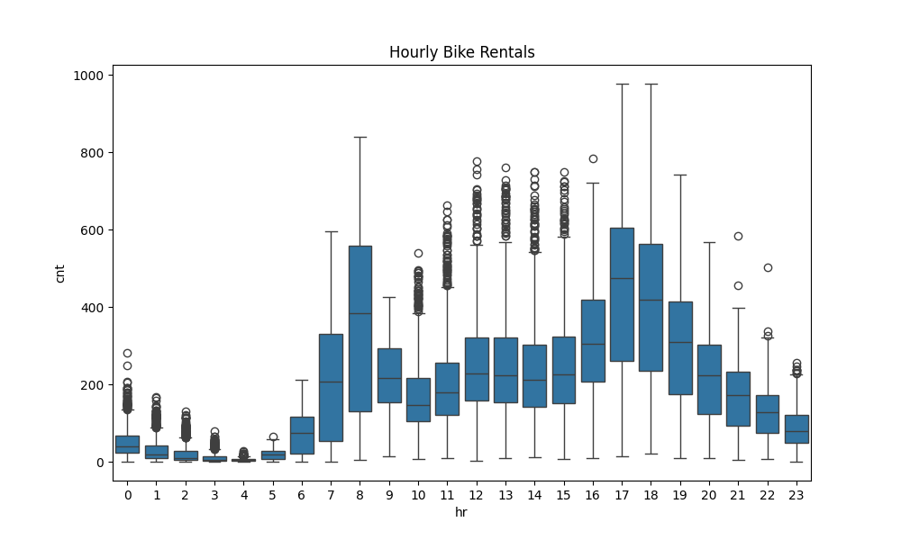
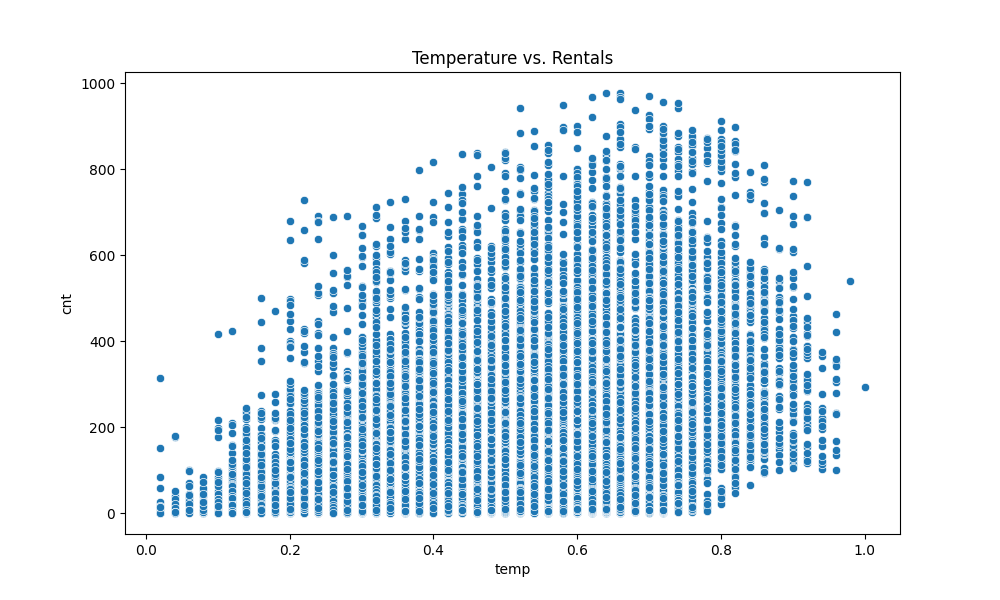

# Bike Sharing Demand Prediction

This project predicts how many bikes are rented in each hour using weather and calendar features. It runs an exploratory data analysis, then compares three regression models (k-NN, Decision Tree and Random Forest) with 10-fold cross-validation.

## Dataset

The project uses the **Bike Sharing Dataset** (`hour.csv`), which has **17,379 hourly records** from the Capital Bikeshare system in Washington, D.C. for 2011 and 2012. Each row combines the rental count with weather and seasonal information.

* **Target:** `cnt`, the total number of rented bikes in that hour.
* **Features:** season, year, month, hour, holiday, weekday, working day, weather situation, temperature, feeling temperature, humidity and wind speed.

The dataset is licensed under [CC BY 4.0](https://creativecommons.org/licenses/by/4.0/) and is included here with attribution:

> Fanaee-T, H. (2013). *Bike Sharing* [Dataset]. UCI Machine Learning Repository. https://doi.org/10.24432/C5W894

## Methodology

**Exploratory Data Analysis**

Two plots are produced and saved as PNG files:

| Hourly rentals by hour of day | Temperature vs. rentals |
| :---: | :---: |
|  |  |

* **Hour of the day:** Rentals peak around 08:00 and again around 17:00-18:00, which points to commuting traffic.
* **Temperature:** Rentals rise as the temperature rises, then drop slightly at extremely high temperatures.

**Pre-processing**

* `season`, `weathersit`, `mnth`, `hr` and `weekday` are one-hot encoded (`drop_first=True`).
* `instant` and `dteday` are dropped because they are an index and a date.
* `casual` and `registered` are dropped because they add up to `cnt`. Keeping them would leak the answer into the features.

**Models**

| Model | Configuration |
| :--- | :--- |
| **k-NN** | `k=5`, inside a pipeline with `StandardScaler`, because distance-based models are sensitive to feature scale |
| **Decision Tree** | `random_state=42` |
| **Random Forest** | `n_estimators=100`, `random_state=42` |

**Evaluation:** 10-fold cross-validation (`KFold`, shuffled, `random_state=42`) with MAE, RMSE and MAPE.

## Results

| Model | MAE | RMSE | MAPE |
| :--- | :---: | :---: | :---: |
| k-NN | 54.29 | 82.07 | 0.559 |
| Decision Tree | 44.51 | 74.48 | 0.571 |
| **Random Forest** | **33.10** | **52.25** | **0.529** |

**Random Forest** is the best model on all three metrics. Averaging many trees reduces the variance of a single Decision Tree, and the trees can model the non-linear interaction between hour, weather and season that distance-based k-NN captures less well.

## Repository Structure

```text
bike_sharing_demand_regression/
├── main.py
├── hour.csv
├── hourly_rentals.png
├── temp_vs_rentals.png
├── requirements.txt
└── README.md
```

## Installation & Usage

1. Clone the repository:
   ```bash
   git clone https://github.com/usakgun/bike_sharing_demand_regression.git
   cd bike_sharing_demand_regression
   ```
2. Install the requirements:
   ```bash
   pip install -r requirements.txt
   ```
3. Run the script:
   ```bash
   python main.py
   ```

The script re-creates the two PNG plots, opens them in plot windows, and prints the cross-validation results to the console. Training the Random Forest takes a short while.

## Technologies

* **Python**
* **Pandas & NumPy:** Data loading and manipulation.
* **Matplotlib & Seaborn:** Exploratory plots.
* **Scikit-Learn:** Pipelines, regression models, cross-validation and metrics.
